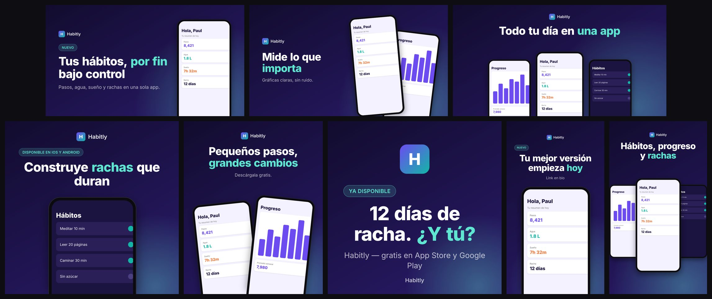

# /social-shots

Turn your mobile app (Expo / React Native first) into a ready-to-post set of social media
images: real screenshots in phone mockups, on-brand headlines, and captions. In one
language, several languages, or bilingual with translation subtitles. Like
[/brag](https://github.com/latent-spaces/brag), but for images.



## Install

### Claude Code (plugin)

```
/plugin install social-shots --marketplace obedvs/social-shots
```

Or in two steps (any Claude Code version with plugins):

```
/plugin marketplace add obedvs/social-shots
/plugin install social-shots@social-shots
```

Update later with `/plugin marketplace update social-shots`. As a plugin the skill runs
as `/social-shots:social-shots`; you can also just ask for "social images for my app".

### Any agent (Claude Code, Cursor, Codex, Gemini CLI, opencode…)

```bash
npx skills add https://github.com/obedvs/social-shots          # this project
npx skills add https://github.com/obedvs/social-shots -g       # every project
```

Installing into a project (`.claude/skills/social-shots/`) and committing it is the way
to use the skill in cloud sessions too (e.g. Claude Code on the web): it travels with the
repo, so any session that opens the project has it.

### Manual

```bash
git clone https://github.com/obedvs/social-shots ~/.claude/skills/social-shots
cd ~/.claude/skills/social-shots && npm install
```

Dependencies are installed automatically the first time the skill runs, so `npm install`
is optional in the first two methods. Requires Node 18+.

## Use

From your app's root, ask your agent:

```
/social-shots
/social-shots --tone "indie hacker build in public" --lang es --formats x,ig-portrait,story
/social-shots --multi es,en          # one set per language: out/es/, out/en/
/social-shots --bilingual es,en      # Spanish headline + English subtitle: out/es+en/
```

You'll get `social-shots/` in your project with the images in `out/`, the plan in
`shots.json`, and captions for each language. Re-run it any time; edit `shots.json` and
re-render to tweak copy or colors.

## What you get

- **Languages:** one set in one language, one set per language (`out/es/`, `out/en/`), or
  bilingual images with the translation as a subtitle line (`out/es+en/`). Latin, Cyrillic,
  Greek and Vietnamese work out of the box; CJK, Arabic, Thai and others need a Noto Sans
  file in `brand.fonts.fallback`.
- **Templates:** `hero` (1 phone), `duo` (2 tilted phones), `trio` (3 phones),
  `statement` (icon + text).
- **Formats:** X, LinkedIn, `og:image`, Instagram square and 4:5, Stories / Reels cover,
  Product Hunt gallery.

The full reference lives in one place each: the workflow, modes, formats and copy rules in
[SKILL.md](SKILL.md), every `shots.json` field in [shots.schema.json](shots.schema.json)
(add `"$schema": "<path>/shots.schema.json"` for editor autocomplete), and sample output in
[examples/](examples/).

## Render manually

```bash
npm install
npm run render -- examples/shots.json --out out
npm run render -- examples/shots.json --mode bilingual --langs es,en --out out
```

`--out` is relative to the current directory. Run `npm run render` with no arguments for
every option.

## Evals

`evals/` holds three test cases in the `claude plugin eval` format: a full English run on
an Expo app, a bilingual app with no screenshots yet, and a quick accent-color re-render.
From the repo root:

```bash
claude plugin eval . --allow-tools Write,Edit,Bash --scaffold
```

These are real, billed model runs.

## How it works

TypeScript + [Satori](https://github.com/vercel/satori) (layout → SVG) +
[resvg](https://github.com/yisibl/resvg-js) (SVG → PNG). No API keys, no network at render
time, fully deterministic: the agent writes copy and colors into `shots.json` and iterates.

## License

MIT
